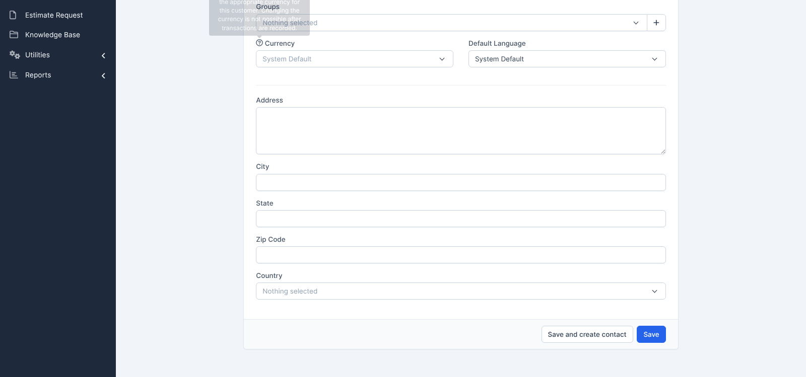

# Execution Report — Customers · Bộ TC (Part 01 — Vòng 1 Smoke)

| Thông tin | Nội dung |
|---|---|
| Run ID | `run_1791988426` |
| Nền tảng | `web` |
| Loại nguồn | `Bộ TC` |
| Nguồn TC | [`docs/testcases/customers/web/parts/part_01_web_smoke.md`](../../../../testcases/customers/web/parts/part_01_web_smoke.md) |
| Phạm vi | 10 TC đầu chưa chạy: `CRM_CUST_TC_001` → `CRM_CUST_TC_010` (kế hoạch chạy 10 TC/ngày). Loại 0 TC `@Deprecated`. Login: 51/51 TC đã có kết quả ở các lần chạy trước → không còn TC chưa chạy; Customers: 0/129 TC đã chạy trước đó |
| Môi trường | `https://crm.anhtester.com` — Perfex CRM demo (dùng chung) |
| Build / Version | Không có thông tin |
| Tài khoản | Admin (`EMAIL_ADMIN` trong biến môi trường — không ghi mật khẩu) |
| Người thực hiện | Agent chạy theo lịch (scheduled routine) |
| Bắt đầu → Kết thúc | 14-10-2026 14:33 → 14:34 (giờ máy chủ UTC) |
| Môi trường dùng chung? | Có — auto-skip TC phá huỷ đang BẬT (10 TC này không có TC phá huỷ) |

> ⚠️ **Ngoại lệ so với Browser Rules:** Playwright MCP không khởi động được trong môi trường cloud (thiếu Google Chrome: `Chromium distribution 'chrome' is not found`), và container không có màn hình để chạy headed. Lần chạy này dùng **Chromium headless của Playwright, viewport `1600×750`**, thao tác theo đúng từng bước TC bằng script, đối chiếu Expected qua DOM + màu/vị trí thực tế; các điểm nghi ngờ được xác nhận lại bằng ảnh chụp. Không có `browser_snapshot` của MCP. Đề nghị chạy lại các TC giao diện (TC_002, 003, 005–007) trên headed khi có máy.

## 1. Tổng kết

| Trạng thái | Số lượng | Tỷ lệ |
|---|---|---|
| ✅ PASS | 9 | 90.0% |
| ❌ FAIL | 1 | 10.0% |
| ⚠️ BLOCKED | 0 | 0% |
| ⏭️ SKIPPED | 0 | 0% |
| **Tổng** | **10** | 100% |

> **Pass rate (không tính SKIPPED):** 9/10 = 90.0%. Tiến độ Customers: 10/129 TC đã chạy.

## 2. Kết quả từng TC

| TC ID | Test Scenario | Kết quả | Bước fail | Ghi chú |
|---|---|---|---|---|
| CRM_CUST_TC_001 | Mở màn hình danh sách khách hàng bằng mọi lối vào | ✅ PASS | — | Cả 2 biến thể `a` `b`; 🔧 HTTP 200 + class `clients` đạt |
| CRM_CUST_TC_002 | Thanh công cụ và khối Customers Summary | ✅ PASS | — | 5 mục bảng kiểm đạt; `Total` = `Active` + `Inactive` (2774 = 2765 + 9) |
| CRM_CUST_TC_003 | Bảng danh sách đúng cấu trúc cột và trạng thái mặc định | ✅ PASS | — | 6 mục đạt; ô `1` tô xanh xác nhận bằng ảnh |
| CRM_CUST_TC_004 | Dữ liệu hiển thị đúng định dạng, rê chuột hiện thao tác nhanh | ✅ PASS | — | Tiền đề tự dựng: `Auto_CUST_TC004_1791988426` (Phone `0901234567`) thay cho dữ liệu mẫu trong TC; đã xoá |
| CRM_CUST_TC_005 | Biểu mẫu thêm khách hàng đủ thành phần | ✅ PASS | — | 🔧 `autofocus="1"`, `POST` đạt |
| CRM_CUST_TC_006 | Các ô chọn ở trạng thái mặc định | ❌ FAIL | 🔧 Ghi chú kỹ thuật | Chỉ phần 🔧 lệch — xem chi tiết #1. 6 mục bảng kiểm chính đều đạt |
| CRM_CUST_TC_007 | Tab Billing & Shipping hiển thị đủ hai khối địa chỉ | ✅ PASS | — | Chú giải Shipping đúng nguyên văn |
| CRM_CUST_TC_008 | Mở biểu mẫu thêm khách hàng bằng mọi lối vào | ✅ PASS | — | Cả 2 biến thể `a` `b` |
| CRM_CUST_TC_009 | Tạo khách hàng chỉ với Company | ✅ PASS | — | Tạo thành công, mở hồ sơ `#{id} <tên>`, đã xoá, tìm lại `No matching records found` |
| CRM_CUST_TC_010 | Tạo khách hàng đầy đủ rồi mở lại đối chiếu | ✅ PASS | — | 12 ô Customer Details + 10 ô billing/shipping đúng từng ký tự; nhóm đã chọn `123` |

## 3. Chi tiết TC FAIL

### FAIL #1 — CRM_CUST_TC_006 · Các ô chọn trên biểu mẫu thêm mới ở đúng trạng thái mặc định

| | |
|---|---|
| REQ ID | REQ-CUST-28, REQ-CUST-30, REQ-CUST-31, REQ-CUST-32, REQ-CUST-84 |
| Priority | Medium |
| Bước fail | Phần 🔧 Ghi chú kỹ thuật (bảng kiểm 1–6 đều đạt) |
| **Expected** | Số `<option>`: `groups_in[]` **305** · `default_currency` 3 · `default_language` 27 · `country` 251; `Vietnam` = `243` |
| **Actual** | `groups_in[]` = **311**; các số còn lại và `Vietnam` = `243` khớp |
| Nhận định | Số nhóm khách hàng là **dữ liệu dùng chung, người khác thêm được** (chênh +6 so với lúc viết TC) — nhiều khả năng **TC hard-code số thay đổi được**, không phải lỗi hệ thống. **Không báo bug**; đối chiếu lại TC |
| Evidence |  |
| Tái hiện được? | Có — lần chạy thử trước đó cũng ra 311 |

## 4. TC BLOCKED

Không có.

## 5. Dữ liệu đã tạo & dọn dẹp

| Dữ liệu | Nơi tạo | Đã xoá? |
|---|---|---|
| Auto_CUST_TC004_1791988426 | `/admin/clients/client` | ✅ |
| Auto_CUST_TC009_1791988426 | `/admin/clients/client` | ✅ |
| Auto_CUST_TC010_1791988426 | `/admin/clients/client` | ✅ |

> Đối chiếu số liệu hệ thống: `Total/Active/Inactive Customers` trước 2774/2765/9 → sau 2774/2765/9 ✅. Lần chạy thử đầu (cùng ngày, trước run này) tạo và xoá 3 bản ghi tương tự `Auto_CUST_TC00x/010_1791988273`; số liệu cuối khớp nên coi như đã dọn.

## 6. Đề xuất bước tiếp theo

- FAIL #1 → **không** `/create-bug-report`; dùng `/review-testcases` mode FIX để bỏ/nới con số 305 ở phần 🔧 của TC_006.
- Ngày kế tiếp: chạy `CRM_CUST_TC_011` → `CRM_CUST_TC_020` (còn 119 TC Customers chưa chạy).
- Cần sửa Playwright MCP trong môi trường cloud (cài Chrome hoặc trỏ `executablePath` Chromium) để chạy headed/snapshot đúng quy định.
